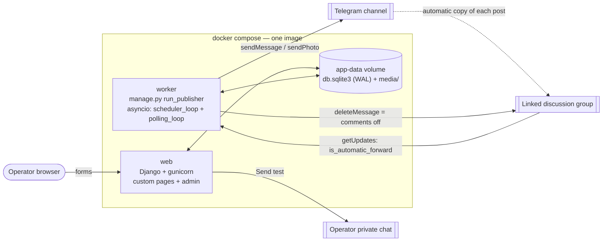

# Regional Price & Deals — Fergana Valley channel platform

An operator-only platform for a read-only Telegram channel about prices and deals in the
Fergana Valley (Qo'qon, Farg'ona, Andijon, Namangan, Marg'ilon). The operator enters
prices, compares baskets, generates posts and schedules them in a Django web app. A
separate worker publishes the posts to the channel and switches comments on or off for
each post.

**Stack:** Python 3.12 · Django 5.2 · SQLite (WAL) · aiogram 3 · gunicorn + whitenoise ·
Docker Compose · Chart.js and Tom Select from a CDN (no frontend build step).

---

## 1. Quick start

```bash
git clone <repo-url> && cd <repo>
cp .env.example .env            # then fill in the Telegram values (see section 2)
docker compose up --build -d    # web on http://localhost:8000, worker starts after web is healthy

docker compose exec web python manage.py seed_demo          # demo data (add --reset to start over)
docker compose exec web python manage.py createsuperuser    # your operator account
```

Open http://localhost:8000 and log in. All operator pages require a **staff** user;
superusers are staff. The Django admin is at `/admin/`.

Useful commands:

```bash
docker compose logs -f worker                         # watch the publisher
docker compose exec web python manage.py test         # run the test suite
docker compose down            # stop (data stays in the "app-data" volume)
docker compose down -v         # stop AND delete the database and media
```

Local development without Docker:

```bash
python3.12 -m venv .venv && . .venv/bin/activate
pip install -r requirements.txt
export DJANGO_DEBUG=1
python manage.py migrate && python manage.py seed_demo && python manage.py createsuperuser
python manage.py runserver            # in a second terminal: python manage.py run_publisher
```

## 2. Telegram setup checklist

1. Create a bot with [@BotFather](https://t.me/BotFather) → `/newbot` and copy the token
   into `TELEGRAM_BOT_TOKEN`.
2. Create a **test** channel. Do not use the client's real channel during development.
3. Create a **test group**, then in the channel open *Settings → Discussion → Add group*
   and link it. Comments under channel posts live in this group.
4. Add the bot as an **administrator of the channel** with the *Post messages* right.
5. Add the bot as an **administrator of the discussion group** with the *Delete messages*
   right. The bot needs admin status in the group to receive all of its messages, so
   privacy mode does not matter.
6. Get the IDs:
   - Channel: forward a channel post to [@userinfobot](https://t.me/userinfobot), or use
     `@channel_username`. Private channels look like `-100…`.
   - Group: add [@RawDataBot](https://t.me/RawDataBot) for a moment and read `chat.id`
     (`-100…`). It must be the **numeric** id.
   - Your own chat, for the "Send test" button: message @userinfobot. You also have to
     press **Start** in your bot once, otherwise it is not allowed to write to you.
7. Put the values in `.env` and run `docker compose up -d` again.

**Two common pitfalls (the worker logs both clearly):**

- **Use a dedicated bot.** If the token belongs to a bot that already has a **webhook**
  (for example a Livegram or other support-bot service), Telegram refuses `getUpdates`.
  The worker then never sees the discussion-group copies, and comments cannot be turned
  off. Publishing still works. Check with
  `https://api.telegram.org/bot<TOKEN>/getWebhookInfo`: `url` must be empty. Create a new
  bot, or call `deleteWebhook`. Deleting the webhook disconnects the other service.
- **The group ID changes when it is linked.** Linking an ordinary group to a channel
  converts it into a supergroup with a **new** `-100…` ID. Use the ID *after* linking:
  `getChat` on the channel shows it as `linked_chat_id`.

## 3. Environment variables

| Variable | Default | Purpose |
|---|---|---|
| `DJANGO_SECRET_KEY` | insecure dev key | Django signing key. **Set it in production.** |
| `DJANGO_DEBUG` | `0` | `1` enables debug pages. |
| `DJANGO_ALLOWED_HOSTS` | `localhost,127.0.0.1` | Comma-separated. Keep `localhost`: the Docker healthcheck uses it. |
| `DJANGO_CSRF_TRUSTED_ORIGINS` | empty | E.g. `http://192.168.1.10:8000` when the app is opened from another host. |
| `TELEGRAM_BOT_TOKEN` | empty | Bot token. The worker refuses to start without it. |
| `TELEGRAM_CHANNEL_ID` | empty | `-100…` or `@username`. The worker refuses to start without it. |
| `TELEGRAM_DISCUSSION_GROUP_ID` | empty | Numeric id of the linked group. If empty, comments cannot be turned off. |
| `TELEGRAM_TEST_CHAT_ID` | empty | Operator's private chat for "Send test". If empty, the button is hidden. |
| `PUBLISHER_INTERVAL_SECONDS` | `15` | How often the worker looks for due posts. |
| `PRICE_ALERT_PERCENT` | `10` | Dashboard threshold for week-over-week price changes. |
| `DATA_DIR` | `./data` (`/data` in Docker) | Holds `db.sqlite3` and `media/`. |

## 4. Architecture



- **web** runs `migrate`, then gunicorn. Its healthcheck calls `/healthz/`, a view that runs
  `SELECT 1`.
- **worker** starts only when web is *healthy* (`depends_on: condition: service_healthy`),
  so migrations have always run before it touches the database.
- Both services use the same image and the same named volume. Media files are served by
  Django itself, which is enough for a single-operator internal tool.

### Django apps

| App | Responsibility |
|---|---|
| `core` | Staff-only mixin, dashboard, `/healthz/`, template filters (`som`, `qty`, …), `seed_demo` |
| `locations` | `City`, `Store`, store pages |
| `catalog` | `Category`, `Product`, `Price`; price services (current prices, chart, alerts); product pages and fast price entry |
| `baskets` | `Basket`, `BasketItem`; comparison service and pages |
| `posts` | `Rubric`, `Post`; hashtags, formatting, generators, publisher (database side), telegram (API side), worker (asyncio) |

Business logic lives in service modules (`catalog/services.py`, `baskets/services.py`,
`posts/*.py`). Views only handle HTTP.

## 5. Data model

```mermaid
erDiagram
    City ||--o{ Store : has
    Category ||--o{ Product : groups
    Product ||--o{ Price : "priced in"
    Store ||--o{ Price : "sells at"
    Basket ||--o{ BasketItem : contains
    Product ||--o{ BasketItem : "is in"
    Rubric ||--o{ Post : classifies
    Post }o--o{ Product : mentions
    Post }o--o{ Store : mentions
    Post }o--o{ City : targets

    City {
        string name UK
        string name_ru
        string hashtag UK "without #"
    }
    Store {
        string name
        fk city
        string address
        url map_url
        decimal latitude
        decimal longitude
        date opened_on
        bool is_new
        bool is_active "false = closed"
    }
    Category {
        string name UK
        string name_ru
    }
    Product {
        int id PK "the unique product ID"
        string name
        string name_ru
        fk category
        enum unit "kg, l, pcs, pack"
        string brand
        text description
        image photo
    }
    Price {
        fk product
        fk store
        int price "so'm"
        date recorded_on
        bool is_promo
        int old_price
        date promo_starts
        date promo_ends
        datetime created_at
    }
    Basket {
        string name UK
        text description
    }
    BasketItem {
        fk basket
        fk product
        decimal quantity "> 0"
    }
    Rubric {
        slug code UK
        string name
        string name_ru
        string hashtag
    }
    Post {
        fk rubric
        enum language
        text text
        image photo
        string extra_hashtags
        bool comments_enabled
        bigint discussion_message_id
        bool comments_closed
        datetime scheduled_at
        enum status
        bigint telegram_message_id
        datetime published_at
        text error_message
    }
```

Design decisions:

- **Price history is append-only.** A price change creates a new `Price` row and nothing is
  ever overwritten. This history is what powers comparisons, charts and alerts.
  - "Latest" means the newest `recorded_on`; ties are broken by `created_at`, then `pk`.
  - The index `(product, store, -recorded_on, -created_at)` serves exactly this lookup.
- **`PriceQuerySet.latest_per_store()`.** SQLite has no `DISTINCT ON`. Each row is kept
  only if its pk equals a correlated subquery: "the newest pk for the same product and
  store". The result is one query, with no Python-side grouping.
- **Promotions are prices.** A promo row stores the promo price in `price`, the regular
  price in `old_price`, and an optional validity period.
  - `Price.current_value(date)` returns `old_price` once the promo has expired (or before
    it starts). Comparisons therefore never use a stale discount.
  - Integrity is enforced twice. `CheckConstraint`s in the database cover price > 0,
    old_price > price and a valid period. `Price.clean()` gives readable form errors, for
    example "a promo needs an old price" or "non-promo rows must leave promo fields empty".
- **Money is an integer number of so'm** (`PositiveIntegerField`). There are no fractions
  and no float rounding problems.
- **`on_delete=PROTECT`** on every link to prices and products. A product with history
  cannot be deleted by accident. A store is *closed* (`is_active=False`), not deleted, so
  its history stays.
- **Rubric is a model, not `choices`.** The operator can add a rubric in the admin without
  a code change. The six default rubrics come from the data migration
  `posts/0002_default_rubrics`.
- **Hashtags are stored without `#`** and validated as `^[a-z0-9_]+$`. The `#` is added
  when the hashtags are built.
- **Russian readiness:** `name_ru` on cities, categories, products and rubrics, and a
  `language` field on posts.

## 6. Price comparison logic

`baskets.services.compare_basket(basket, city=None)`:

1. Load the basket items and the **latest** price of each basket product in every
   **active** store, optionally filtered by city.
2. For each store and item:
   - Line cost = `quantity × current_value`, rounded `ROUND_HALF_UP` to whole so'm. For
     example, 0.5 kg × 12 345 = 6 173.
   - A product without a price in that store goes into `missing`. **It is never counted
     as 0.**
3. `total` is the sum of the lines that have a price.
4. The ranking key is `(number of missing products, total, store name)`. Complete baskets
   always rank above incomplete ones, so a store does not "win" because it lacks the
   expensive items. The page shows the missing product names.
5. Stores with no price for any basket product are left out.

The product page uses `catalog.services.current_prices()`: the latest price per active
store, cheapest first, with the cheapest row highlighted. It also shows a Chart.js history
chart: one line per store, `null` where a store has no entry that day (`spanGaps`).

**Price alerts (bonus):** for every current price, the dashboard compares it with the
newest price recorded on or before 7 days ago, and lists changes ≥ `PRICE_ALERT_PERCENT`.

## 7. Posts, hashtags, formatting

### Hashtags

`posts/hashtags.py`:

- `normalize_hashtag` lower-cases the tag, strips `#`, and removes the apostrophes
  `' ` ʻ ʼ ‘ ’`, so `Qo'qon` becomes `qoqon`. Spaces and hyphens become `_`, and other
  symbols are dropped. Empty or digits-only tags are rejected, because Telegram would not
  link them.
- `build_hashtags` orders the tags **rubric → cities → extras** and removes duplicates.
  - City tags come from the post's cities **and** from the cities of its linked stores.
  - `posts.models.hashtags_for()` is the single function that builds them. The form
    preview and the worker both use it, so they can never disagree.

### Formatting and escaping

The operator writes plain text with two markers, `**bold**` and `~~strike~~`.
`to_telegram_html` works in this order:

1. `html.escape(text, quote=False)` **first**. Everything the operator typed is shown
   literally: `<`, `&`, `M&M's`, even `<b>` typed by hand.
2. **Then** it turns the markers into `<b>`/`<s>`.

In the other order, the escaping would also destroy our own tags. Tags only ever come from
the markers, so the HTML Telegram receives is always valid.

### Length

Telegram limits a message to 4096 characters and a photo caption to 1024, counted in
**UTF-16 code units** after formatting is removed. Most emoji count as 2.
`PostForm.clean()` composes the exact final text (text + blank line + hashtags), measures
`telegram_length(visible_text(...))`, and refuses to save if it is over the limit. The
worker checks again just before sending.

### Preview

The editor has three buttons: **Preview**, **Save draft** and **Schedule**. The preview
renders exactly the HTML that will be sent, inside a Telegram-style bubble, with an
`N / limit` counter.

### Generators

`posts/generators.py` creates **draft** posts from data:

| Generator | Source data |
|---|---|
| Promotions | Active promotions, for a city or a store |
| Product price | All stores, cheapest first |
| Basket comparison | The basket ranking |
| New store | A store marked `is_new` |

- The wording is in `templates/posts/generators/*.txt`, not in Python. These are
  translatable templates (``), rendered inside
  `translation.override(post.language)`.
- They render with ``: the output is plain text, and escaping happens
  only once, at send time.
- When there is no data, the generator raises `GeneratorError` with a readable message.
- Review, life-hack and news posts are written by hand.

## 8. Scheduling: why a custom loop, and why aiogram

**Why not Celery.** The workload is a handful of posts per day for one channel. Celery
would add a broker (Redis), a beat scheduler and two more containers, and it still would
not solve the hard part, which is never sending a post twice. A 15-second asyncio loop
that asks the database "which scheduled posts are due?" is easy to reason about, and
easy to explain:

- The database is the queue.
- `Post.status` is the state machine.
- Restarting the worker loses nothing.

**Why aiogram 3.**

- It is fully **async**. One process runs the scheduler and the update polling
  concurrently, without threads.
- It has typed models for exactly the objects the comment mechanism depends on:
  `Message.is_automatic_forward`, `forward_origin` and `MessageOriginChannel`.
- Its exceptions are fine-grained (`TelegramRetryAfter`, `TelegramBadRequest`,
  `TelegramNetworkError`, …). That makes the error table below possible.
- It has a clean `Dispatcher` with `handle_signals=False`, so the worker controls its own
  shutdown.

python-telegram-bot 21 would also work. aiogram's lighter, explicitly async design fits a
worker that never needs conversations or handlers for end users.

The worker (`posts/worker.py`) runs two tasks:

- `scheduler_loop`, every `PUBLISHER_INTERVAL_SECONDS`:
  1. `close_old_connections()`
  2. publish all due posts, one by one
  3. close pending comments

  Exceptions are logged and never kill the loop.
- `polling_loop`: aiogram long polling with `allowed_updates=["message"]`, used only to
  see the discussion group. If it crashes it restarts after 10 s. It runs only if
  `TELEGRAM_DISCUSSION_GROUP_ID` is set.

SIGTERM and SIGINT set an `asyncio.Event`. On shutdown the worker stops polling, **lets an
in-flight send finish**, and closes the bot session. Compose gives it
`stop_grace_period: 30s`. ORM calls go through `sync_to_async`.

## 9. The at-most-once guarantee

> A post must never be published twice, even if the worker restarts mid-work.

Post states: `draft → scheduled → publishing → published | failed`.

1. **Select:** `Post.objects.due(now)` returns posts where `status = scheduled` and
   `scheduled_at <= now`.
2. **Claim:** this is the critical step.
   ```python
   Post.objects.filter(pk=id, status=SCHEDULED, scheduled_at__lte=now).update(status=PUBLISHING)  # == 1 ?
   ```
   - It is a single conditional `UPDATE`, and SQLite runs it atomically.
   - If two workers, or a worker and an operator edit, race for the same post, only one
     of them sees "1 row updated". **Only that one sends.** Everyone else skips it.
3. **Send** to Telegram.
4. **Record the outcome:**
   - Success: `PUBLISHED`, storing `telegram_message_id` and `published_at`.
   - Error: `FAILED` with the error text (see the table below).
5. **Crash between 2 and 4.** The post stays in `PUBLISHING`. At the next start,
   `recover_interrupted()` turns every `PUBLISHING` post into `FAILED` with the message
   "worker stopped while sending, outcome unknown, check the channel". It is **never
   retried automatically.**
   - We cannot know whether Telegram received the request.
   - A missing post can be rescheduled by the operator in two clicks. A duplicate post in
     a channel with a large audience cannot be taken back.
   - So the guarantee is **at most once**, and the uncertain case goes to a human.
6. **The operator cannot race the worker either.** Saving a post re-reads its status
   inside `transaction.atomic()`.
   - SQLite transactions are opened with `BEGIN IMMEDIATE` (`"transaction_mode":
     "IMMEDIATE"`), so the write lock is held from the check to the save. The worker's
     claim waits for it.
   - Posts in `PUBLISHING` or `PUBLISHED` cannot be edited. The only exception is turning
     comments off.

### Error handling

| Situation | Was it sent? | Result |
|---|---|---|
| Building the message fails (e.g. too long, deleted photo) | No | `FAILED` with the reason |
| `TelegramRetryAfter` (429 flood control) | No, Telegram refused it | Back to `SCHEDULED`, `scheduled_at += retry_after` |
| `TelegramEntityTooLarge` (photo too big) | No | `FAILED` |
| `TelegramNetworkError` / `TelegramServerError` | **Unknown**: the request may have arrived | `FAILED`, "outcome unknown, check the channel", no retry |
| Any other `TelegramAPIError` (bad HTML, no rights, wrong chat, bad token) | No, Telegram answered with an error | `FAILED` with Telegram's message |
| Any other exception | Unknown | `FAILED`, "outcome unknown" |
| Worker killed mid-send | Unknown | `FAILED` at the next start (`recover_interrupted`) |

The dashboard lists recently failed posts. The operator fixes the post and schedules it
again.

## 10. Comments on/off: mechanism and limitations

**How Telegram comments work.** A channel has no comments of its own. When a channel has
a linked discussion group, Telegram **automatically copies every new channel post into
that group**. The copy is a message with `is_automatic_forward = true` and a
`forward_origin` of type `MessageOriginChannel` that holds the channel `message_id`. The
"Comments" button under the channel post is the reply thread of that copy.

**The Bot API has no per-post "comments on/off" parameter.** `sendMessage` and
`sendPhoto` cannot disable comments. Our mechanism:

1. Every post is published normally, so Telegram creates the copy in the group.
2. The worker polls the group. For each automatic forward it links
   `forward_origin.message_id` (the channel message) to `Post.discussion_message_id`.
   - The copy can arrive before `mark_published` has been saved, so linking retries
     5 × 1 s.
3. For a published post with `comments_enabled = False`, the worker calls
   **`deleteMessage` on the copy in the group**.
   - Without the copy there is no thread, so the comment button disappears from the
     channel post.
   - It does this immediately when the copy arrives, and on every tick for anything
     still pending.
   - "message not found" counts as already closed.
   - Then `comments_closed = True`.

**Limitations (as researched):**

- **Nothing can be set before publishing.** The copy only exists after the post is
  published. Every post is born with comments open, and "off" means "closed right after
  publishing".
- **Short window.** Between publication and deletion of the copy (normally about a
  second, at most one scheduler tick) a fast user could open the thread.
- **Closing is irreversible.** A deleted copy cannot be recreated, and the bot cannot
  re-link a thread. Turning comments off *after* publishing works on the next tick.
  Turning them back on after they were closed is **impossible**:
  - The post form refuses it.
  - On a published post the toggle can only go from on to off, and it asks for
    confirmation.
- **The worker must be running** when the copy arrives. If it is down, the copy is not
  linked, and the comments of that post stay open until someone deletes the copy in the
  group by hand. Updates are buffered by Telegram for up to 24 h, so a short restart is
  fine.
- **Required rights:** the bot must be an admin of the group with *Delete messages*. The
  group must be linked to the channel.
- Deleting the copy removes comments that already exist. That is why turning comments
  off is presented as permanent.

An alternative would be to restrict the group's `can_send_messages`. That disables
comments on **all** posts at once, so it cannot give per-post control.

## 11. Internationalisation

- `LANGUAGE_CODE = "uz"`, `LANGUAGES = [("uz", "O'zbekcha"), ("ru", "Ruscha")]`,
  `LocaleMiddleware`, `LOCALE_PATHS = ["locale"]`, the `set_language` view, and a UZ/RU
  switcher in the sidebar.
- Every UI string goes through `gettext` / `` / ``.
  The msgids are written **in Uzbek**, so the UI is complete without any `.po` file.
- **Russian is shipped and working (bonus).** `locale/ru/LC_MESSAGES/django.po` translates
  all UI strings and generator templates, with correct Russian plural forms. The compiled
  `django.mo` is committed, so the Docker image needs no `gettext`.
- **Object names follow the language.** `City`, `Category`, `Product` and `Rubric` use
  `core.localization.LocalizedNameMixin`: `local_name` (and `str()`) returns `name_ru` when
  the active language is Russian and the field is filled in, otherwise `name`. Store names,
  addresses and basket names are proper names or data, so they are not translated.
- **Posts** are generated in the language chosen in the generator form, independent of the
  UI language: `translation.override(post.language)`. Hashtags always stay Latin, so
  `#qoqon` is the same tag in both languages.
- **After changing a UI string or a generator template:**
  ```bash
  python manage.py makemessages -l ru --ignore=.venv   # updates django.po
  # translate the new / fuzzy entries
  python manage.py compilemessages -l ru --ignore=.venv
  ```
  (`gettext` must be installed for these two commands.) Commit both `.po` and `.mo`.

## 12. Operator pages

| Page | URL | Notes |
|---|---|---|
| Login / logout | `/accounts/login/` | Logout is a POST form (CSRF-safe). |
| Dashboard | `/` | Counts, prices entered since Monday, next 10 scheduled posts, last 10 failed posts, price alerts. |
| Products | `/products/` | Search (name / Russian name / brand), category filter, pagination, create/edit with photo (≤ 10 MB). |
| Product detail | `/products/<id>/` | Current prices (cheapest highlighted, promo badge with old price struck through), history chart and table. |
| Stores | `/stores/` | City tabs, create/edit. |
| **Fast price entry** | `/prices/new/` | See below. |
| Baskets | `/baskets/` | Inline formset with "add row"; comparison page with city filter, rank, total, complete/missing badges, line details, and a "Create post" button that pre-fills the generator. |
| Posts | `/posts/` | Status tabs; editor with preview / draft / schedule; read-only view for published posts. |
| Generators | `/posts/generate/` | Four generator forms on one page. |

**Fast price entry** (`/prices/new/`) is built for speed:

- Tom Select search for the product, with autofocus. Picking a product jumps focus
  straight to the price field.
- The store is remembered between entries, in the session.
- **Enter** saves and returns an empty form.
- Promo fields stay hidden until "promo" is ticked.
- A live hint shows "Previous price: X so'm (date), +y%".
- Today's entries are listed below the form.

## 13. Bonus features implemented

- **Send test to me:** a button in the post editor sends the saved post (same HTML, same
  photo) to `TELEGRAM_TEST_CHAT_ID` before scheduling.
- **Working Russian translation:** the interface, generator templates and object names
  (section 11).
- **Price change alerts:** the dashboard table of week-over-week changes ≥
  `PRICE_ALERT_PERCENT`.
- **CI:** GitHub Actions on every push runs ruff, `makemigrations --check` and the test
  suite.

## 14. Tests

Run with `python manage.py test` (70 tests, under 2 s).

| Area | File | What is covered |
|---|---|---|
| Basket comparison | `baskets/tests.py` | Ranking; missing product reported and **not** counted as 0; latest price only; city filter; ROUND_HALF_UP on fractions; stores without prices excluded; closed stores excluded; empty basket |
| Prices | `catalog/tests.py` | `latest_per_store` including same-day ties; expired promo falls back to old_price; promo validation messages; DB constraint; current prices order; chart gaps; price alerts |
| Hashtags | `posts/tests/test_hashtags.py` | Normalisation (apostrophe variants, spaces, hyphens, symbols), rejection of empty or digit-only tags, order and de-duplication |
| Formatting | `posts/tests/test_formatting.py` | Escaping before markers, typed HTML stays literal, UTF-16 counting |
| Due posts / claim | `posts/tests/test_publisher.py` | Only due scheduled posts (draft, publishing, published, failed and future excluded); claim works once; recover_interrupted; postpone; message building; comment linking and the closing queue |
| Worker | `posts/tests/test_worker.py` | `publish_one` with a fake bot: success stores the message_id and a second call is a no-op; BadRequest → FAILED with the error; NetworkError → FAILED "unknown"; RetryAfter → rescheduled; deleting the group copy; "not found" counts as closed |
| Length validation | `posts/tests/test_forms.py` | Text limit including hashtags, caption limit with photo, emoji as 2 units, markers not counted, schedule requires a time, closed comments cannot be reopened |
| Views | `posts/tests/test_views.py`, `core/tests.py` | Editing a post that is being published is refused; published posts only allow comments off; preview does not save; every page returns 200 for staff, redirects anonymous users, and gives 403 to non-staff; fast price entry keeps the store |
| Generators | `posts/tests/test_generators.py` | Price post cheapest first with the right hashtags; every generator raises `GeneratorError` without data |

## 15. Known limitations

- **SQLite** with WAL and `BEGIN IMMEDIATE` handles one operator and one worker
  comfortably. It is not meant for many concurrent writers. Moving to PostgreSQL only
  needs a change to `DATABASES`.
- **At-most-once delivery** means an uncertain send (network error, crash) becomes
  `FAILED` and needs a human to look at the channel. This is deliberate (section 9).
- **Comments** are open for a short moment after publishing, closing is permanent, and
  closing needs the worker to be running (section 10).
- **Scheduling precision** is ±`PUBLISHER_INTERVAL_SECONDS` (15 s by default). Posts due
  at the same time go out one after another.
- **Media** is served by Django. That is fine for an internal tool, but there is no CDN
  and no thumbnailing. Photos are sent to Telegram as uploaded (Telegram's photo limit is
  10 MB, which matches the form limit).
- Worker error messages saved in `Post.error_message` are stored in the default language
  (Uzbek), because the worker has no user language.
- The dashboard counts "prices entered since Monday" by `created_at`. After `seed_demo`
  this includes all the seeded history, because it was all inserted today.
- Prices are per store, not per branch inventory. "Missing" means "no price recorded",
  which is not necessarily "out of stock".
